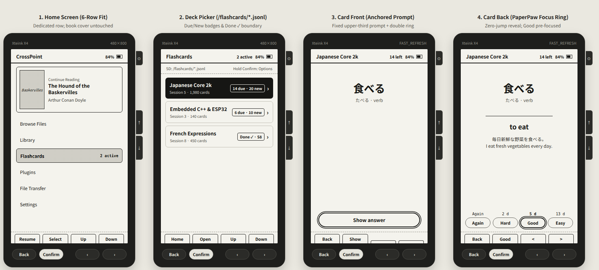
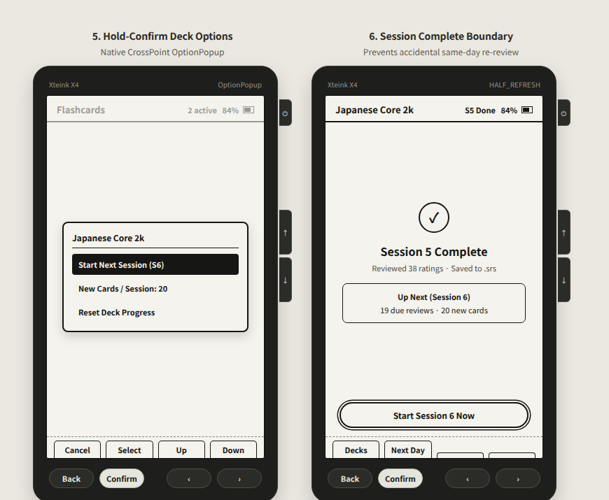

# Flashcards Subsystem — Technical Architecture

This document locks in the technical design for adding a standalone, offline flashcards subsystem to this CrossPoint Reader fork.

The primary engineering goals are:
1. **First-class integration**: Dedicated Home menu entry, native deck picker, and independent sleep/wake session resume without piggybacking on `openEpubPath` or `RECENT_BOOKS`.
2. **Minimal upstream diff**: Isolate 95%+ of code in new directories (`lib/Flashcards/`, `src/activities/flashcards/`), add zero external dependencies, touch zero translation files, and keep upstream edits small and localized so merging future CrossPoint releases stays trivial.
3. **Xteink X4 (ESP32-C3) hardware fit**: Respect the ~380 KB SRAM / no-PSRAM budget, avoid heap fragmentation, survive sudden `0V` battery sleep cutoffs (`GPIO13` MOSFET), and operate 100% offline with zero RTC or Wi-Fi requirement.

---

## 1. Repository Layout & Upstream Touchpoints

### 1.1 New Isolated Files (Owned Exclusively by Fork)

```text
lib/Flashcards/
  FlashcardTypes.h              # POD records (.idx, .srs, .wal), constants, FNV-1a 64-bit hash
  FlashcardScheduler.h / .cpp   # Stateless FSRS-5 scheduler + intra-session step logic
  FlashcardDeckIndex.h / .cpp   # Streaming .jsonl parser & fixed-stride .idx builder/reader
  FlashcardSrsStore.h / .cpp    # Binary .srs table + CRC32 append-only .wal persistence
  FlashcardSession.h / .cpp     # Session-day queue builder, mid-session recovery, card loader
src/activities/flashcards/
  FlashcardsDeckListActivity.h / .cpp   # UiListActivity scanning /flashcards/*.jsonl + due/new counts
  FlashcardsReviewActivity.h / .cpp     # Card front/back renderer & rating loop
src/components/icons/
  flashcards.h                  # 32x32 1-bit monochrome icon bitmap in PROGMEM/flash
test/flashcards/
  CMakeLists.txt                # Host-native GoogleTest target (no hardware needed)
  FlashcardsTest.cpp            # Tests FSRS-5, .jsonl indexing, .wal recovery, session pacing
tools/
  deck2jsonl.py                 # Optional host Python stdlib converter (.apkg, .tsv, .csv -> .jsonl)
docs/
  flashcards-architecture.md    # This specification
```

### 1.2 Upstream Files Modified (~6 Files, Surgical Diffs)

To keep `git merge upstream/develop` (or `upstream/master`) nearly conflict-free:
- **No changes** to `platformio.ini` (reuses bundled `ArduinoJson 7.4.2` and `Serialization.h`).
- **No changes** to `lib/I18n/translations/*.yaml` (Flashcards UI strings live in `src/activities/flashcards/` as `constexpr` English literals so upstream translation churn never conflicts).
- **No changes** to `CrossPointSettings` unless global Flashcards settings are explicitly needed later.

| Upstream File | Exact Change | Purpose |
|---|---|---|
| `src/activities/ActivityManager.h` & `.cpp` | Add `HomeMenuItem::FLASHCARDS`, `goToFlashcards(std::string deckPath = {}, bool allowFastInitialRefresh = false)`, `isFlashcardsReviewActivity()`, and map `"FlashcardsDeckList"` / `"FlashcardsReview"` -> `HomeMenuItem::FLASHCARDS` in `goHome()`. | Central navigation dispatch. |
| `src/activities/home/HomeActivity.h` & `.cpp` | Insert `HomeMenuItem::FLASHCARDS` into `menuItemToIndex()`, `indexToMenuItem()`, and `HomeActivity::render()` menu vectors. | Dedicated **Flashcards** row on all list-based Home themes. |
| `src/components/CoverGridHomeUi.h` & `.cpp` | Grow `tabItems` array `5 -> 6` and draw `FlashcardsIcon` in `drawTabs()`. | Dedicated **Flashcards** tab on PSRAM cover-grid Home themes. |
| `src/components/themes/BaseTheme.h/.cpp`, `lyra/LyraTheme.cpp`, & `roundedraff/RoundedRaffTheme.cpp` | Add `UIIcon::Flashcards` and clamp `getHomeMenuRowHeight()` on 6–7-row Home menus. | Prevents Home rows from overlapping bottom button hints (`y = 752` on X3, `y = 760` on X4) in Classic, Lyra 3-Covers, and RoundedRaff, keeping `HomeActivity::loop()` `rowTouch()` aligned. |
| `src/CrossPointState.h` & `.cpp` | Add `std::string openFlashcardsPath`, `bool lastSleepFromFlashcards = false`, `uint8_t flashcardsActivityLoadCount = 0`, and `clearFlashcardsResume()`. | Independent sleep/wake session state (leaves `openEpubPath` and `RECENT_BOOKS` untouched). |
| `src/main.cpp` | In boot wake routing, if `lastSleepFromFlashcards && !openFlashcardsPath.empty() && flashcardsActivityLoadCount == 0` (and `Back` not held), increment `flashcardsActivityLoadCount`, save state, and call `activityManager.goToFlashcards(path, allowFastInitialReaderRefresh)`. | Wakes directly back into an interrupted Flashcards review session with crash-loop protection matching `readerActivityLoadCount`. |

---

## 2. Deck Discovery & Input Format (`/flashcards/*.jsonl`)

### 2.1 Discovery Contract
- Decks live as flat `*.jsonl` files directly inside **`/flashcards`** at the SD card root (case-insensitive on FAT32/exFAT, matching CrossPoint's `/dictionaries`, `/plugins`, and `/fonts` convention).
- Entering `FlashcardsDeckListActivity` creates `/flashcards` (`Storage.mkdir("/flashcards")`) if absent so the directory is immediately visible over USB or Wi-Fi File Transfer.
- Hidden files (`name[0] == '.'`) and non-`.jsonl` files are skipped.
- Because `LibraryBuilder` and `FileBrowserActivity` ignore `.jsonl`, flashcard decks never pollute the EPUB library index (`CLX1`) or book browser.

### 2.2 JSON Lines (`.jsonl`) Schema
Each line (`\n` or `\r\n` terminated, UTF-8, max `4096` bytes per line; longer lines are logged and skipped safely) is a standalone JSON object parsed one line at a time via `ArduinoJson`:

```jsonl
{"_meta":true,"title":"Japanese Core 2k","newPerDay":20,"maxReviews":200}
{"id":"n5-001","front":"食べる","back":"to eat","hint":"たべる","extra":"毎日野菜を食べる。"}
{"front":"飲む","back":"to drink"}
```

- **Optional metadata line (line 1)**: Any object with `"_meta": true` sets deck-level defaults:
  - `"title"` (`const char*`): Display name in deck picker; defaults to filename stem (`japanese.jsonl` -> `"japanese"`).
  - `"newPerDay"` (`uint16_t`, default `20`, clamped `0..200`): New cards introduced per session day.
  - `"maxReviews"` (`uint16_t`, default `200`, clamped `1..500`): Maximum due review cards loaded per session day.
- **Card lines**:
  - `"front"` (**required**, non-empty UTF-8 string): Prompt side.
  - `"back"` (**required**, non-empty UTF-8 string): Answer side.
  - `"id"` (optional string or integer): Stable card identifier.
    - If present, `cardIdHash = fnv1a64(id_bytes)`.
    - If omitted, `cardIdHash = fnv1a64(front_bytes)`.
    - Using a 64-bit content/ID hash decouples SRS history from line numbers: adding, reordering, or fixing typos in `"back"` preserves card progress.
  - `"hint"` (optional string): Secondary cue on the front (e.g., part of speech or reading hint).
  - `"extra"` (optional string): Example sentence or notes shown below `"back"` after flipping.
- **HTML normalization**: Imported card fields containing basic HTML (`<br>`, `<div>`, `<b>`, entities) are cleaned on card load via CrossPoint's existing `HtmlToPlainText` helper (or lightweight tag stripper) before layout.

---

## 3. Binary Cache & Persistence Formats (`/.crosspoint/flashcards/`)

User `.jsonl` files under `/flashcards/` are **strictly read-only**. All generated indexes and review states live under `/.crosspoint/flashcards/<deck_path_fnv64_hex>.{idx,srs,wal}` in ESP32 little-endian POD format (`lib/Serialization/Serialization.h`).

### 3.1 Deck Byte-Offset Index (`<hash>.idx`)

Rebuilt automatically on deck open only when missing, version-mismatched, or `deckFileSize != file.size()`.

```cpp
struct DeckIndexHeader {
  uint32_t magic;          // 0x31444346 ('FCD1')
  uint8_t  version;        // 1
  uint8_t  reserved[3];
  uint32_t deckFileSize;   // Exact byte size of /flashcards/<deck>.jsonl
  uint32_t cardCount;      // Number of valid card records following header
  uint16_t newPerDay;      // Parsed from _meta or default (20)
  uint16_t maxReviews;     // Parsed from _meta or default (200)
  char     title[64];      // Null-terminated UTF-8 display title
}; // 84 bytes

struct CardIndexRecord {
  uint64_t cardIdHash;     // FNV-1a 64-bit card identity
  uint32_t byteOffset;     // Exact byte offset of line in .jsonl
  uint16_t byteLength;     // Exact byte length of line in .jsonl (<= 4096)
  uint16_t flags;          // Reserved (0)
}; // 16 bytes (naturally aligned: 8 + 4 + 2 + 2 = 16 bytes)
```

- **Random access**: Card `k` (`0 <= k < cardCount`) sits at fixed offset `sizeof(DeckIndexHeader) + k * sizeof(CardIndexRecord)`. Zero per-card index array stays resident in RAM.

### 3.2 SRS State Table (`<hash>.srs`)

Stores persistent scheduling state for every card reviewed at least once, sorted ascending by `cardIdHash`.

```cpp
enum class CardState : uint8_t {
  New        = 0,
  Learning   = 1,
  Review     = 2,
  Relearning = 3,
};

struct SrsFileHeader {
  uint32_t magic;              // 0x31535253 ('SRS1')
  uint8_t  version;            // 1
  uint8_t  sessionCompleted;   // 1 if currentSessionDay finished, 0 if in-progress
  uint16_t newThisSession;     // Count of New cards already introduced in currentSessionDay
  uint32_t currentSessionDay;  // Monotonic per-deck session day (starts at 1)
  uint32_t recordCount;        // Number of CardSrsRecord entries
  uint32_t reviewsThisSession; // Completed ratings in currentSessionDay (for summary stats)
  uint16_t newPerDayOverride;  // Optional per-deck new-card override (0 = use deck default)
  uint16_t reserved;           // Explicit alignment padding (0)
}; // 24 bytes

struct CardSrsRecord {
  uint64_t cardIdHash;         // 8 B: Matches CardIndexRecord::cardIdHash
  float    stability;          // 4 B: FSRS-5 stability S (in session-days)
  uint16_t difficultyPermille; // 2 B: FSRS-5 difficulty D * 1000 (clamped 1000..10000)
  uint16_t dueDay;             // 2 B: Next due session-day (saturates at 65535)
  uint16_t lastReviewDay;      // 2 B: Session-day of most recent review
  uint8_t  state;              // 1 B: CardState enum
  uint8_t  lapses;             // 1 B: Saturating lapse count (0..255)
  uint8_t  reserved[4];        // 4 B: Explicit alignment padding (0)
}; // 24 bytes
```

### 3.3 Crash-Safe Write-Ahead Log (`<hash>.wal`)

Rewriting a 100 KB `.srs` file on every button press would add ~200–300 ms of SPI SD latency and risk corruption if power drops. Instead, every card rating appends one **32-byte CRC-protected WAL frame** in ~1–2 ms:

```cpp
enum class WalOp : uint8_t {
  CardRated       = 1, // Updates CardSrsRecord + increments reviewsThisSession (+ newThisSession if first review)
  SessionComplete = 2, // Marks sessionCompleted = 1 for currentSessionDay
  SessionAdvance  = 3, // Advances currentSessionDay = record.dueDay, resets session counters & sessionCompleted = 0
};

struct WalEntry {
  CardSrsRecord card;          // 24 bytes (zeroed for SessionComplete/SessionAdvance except target day)
  uint8_t       op;            // WalOp
  uint8_t       wasNewCard;    // 1 if this rating introduced a previously New card
  uint16_t      sessionDay;    // Session day at time of event
  uint32_t      crc32;         // CRC32 over preceding 28 bytes (offsetof(WalEntry, crc32) == 28)
}; // 32 bytes
```

- **Recovery & Compaction**:
  1. On deck open (`FlashcardSession::open`), if `<hash>.wal` exists, valid frames (`crc32` match) are replayed onto the `.srs` state; a torn trailing frame from power loss is truncated cleanly.
  2. When `walFileSize >= 4096` (~128 ratings), or on `FlashcardsReviewActivity::onExit()` / `prepareForSleep()`, the merged state is written to `<hash>.srs.tmp`, synced/closed, atomically renamed over `<hash>.srs` via `Storage.rename()`, and `<hash>.wal` is removed.

---

## 4. Clockless Session-Paced FSRS-5 Scheduler

### 4.1 Why Clockless Session Pacing on Xteink X4
On Xteink X4 / X3 (`ESP32-C3`), battery sleep (`HalPowerManager::startDeepSleep()`) drives `GPIO13` LOW to cut the battery MOSFET (`0V` power-off), and there is no hardware RTC chip (`HalClock::isAvailable() == false`). In addition, CrossPoint's `TrustedTime` maintains an irreversible monotonic NVS floor for book-loan expiry and must never be mutated manually.

Therefore, time is modeled per deck as an integer **`currentSessionDay` (`1, 2, 3, ...`)** where **1 completed deck session = 1 day**:
- **Mid-session power-off**: If the user sleeps or powers off with cards still remaining in `currentSessionDay`, `sessionCompleted == 0`. Waking up reconstructs the exact remaining due/learning cards plus the remaining `newPerDay - newThisSession` budget for the *same* `currentSessionDay`.
- **Session completion**: Once active cards in `currentSessionDay` hit `0`, a `WalOp::SessionComplete` marker is written (`sessionCompleted = 1`) and the **Session Complete** summary is shown.
- **Next session advance**: Opening a deck whose `sessionCompleted == 1` (or choosing *Start Next Session*) advances `currentSessionDay`:
  - Normally `nextDay = currentSessionDay + 1`.
  - **Empty-day fast-forward**: If `0` unseen New cards remain in the deck *and* no card has `dueDay <= currentSessionDay + 1`, `nextDay` jumps directly to `min(card.dueDay)` across reviewed cards so mastered decks never present empty sessions.

### 4.2 FSRS-5 Math (`FlashcardScheduler`)
Uses FSRS-5's 19 published default weights stored in flash (`76 bytes` of `constexpr float`):

```cpp
inline constexpr float W[19] = {
    0.40255f, 1.18385f, 3.17300f, 15.69105f, 7.19490f,
    0.53450f, 1.46040f, 0.00460f, 1.54575f,  0.11920f,
    1.01925f, 1.93950f, 0.11000f, 0.29605f,  2.26980f,
    0.23150f, 2.98980f, 0.51655f, 0.66210f,
};
```

For rating $G \in \{1\text{ (Again)}, 2\text{ (Hard)}, 3\text{ (Good)}, 4\text{ (Easy)}\}$ on `today = currentSessionDay`:

1. **First review of a `New` card**:
   - $S_0(G) = W[G - 1]$
   - $D_0(G) = \text{clamp}(W[4] - e^{W[5](G - 1)} + 1,\; 1.0,\; 10.0)$
   - If $G = 1$ (`Again`): `state = Learning`, `dueDay = today` (re-queued ~6 cards ahead in RAM session queue).
   - If $G \in \{2, 3, 4\}$: `state = Review`, `dueDay = today + max(1, round(S_0(G)))`.

2. **Same-session follow-up review (`elapsedDays = today - lastReviewDay == 0`, e.g. `Learning` / `Relearning`)**:
   - Short-term stability update: $S' = S \cdot e^{W[17](G - 3 + W[18])}$, difficulty $D' = D$.
   - If $G = 1$ (`Again`): stays in `Learning`/`Relearning`, `dueDay = today` (re-queued in current session).
   - If $G \in \{2, 3, 4\}$: graduates to `state = Review`, `dueDay = today + max(1, round(S'))`.

3. **Inter-session `Review` card (`t = max(1, today - lastReviewDay)`)**:
   - Retrievability at 90% power-law curve:
     $$R(t, S) = \left(1 + \frac{19}{81} \cdot \frac{t}{S}\right)^{-0.5}$$
   - Difficulty update with linear damping & mean reversion toward $D_0(4)$:
     $$D_{\text{tmp}} = D - W[6](G - 3)\frac{10 - D}{9}, \quad D' = \text{clamp}\left(W[7]D_0(4) + (1 - W[7])D_{\text{tmp}},\; 1.0,\; 10.0\right)$$
   - If $G = 1$ (`Again` — lapse):
     $$S' = \max\left(0.1,\; \min\left(S,\; W[11] \cdot (D')^{-W[12]} \cdot \left((S + 1)^{W[13]} - 1\right) \cdot e^{W[14](1 - R)}\right)\right)$$
     `lapses = min(255, lapses + 1)`, `state = Relearning`, `dueDay = today` (re-queued in current session so no card ends a session unlearned).
   - If $G \in \{2, 3, 4\}$ (successful recall):
     $$h = (G == 2) ? W[15] : 1.0, \quad b = (G == 4) ? W[16] : 1.0$$
     $$S' = S \cdot \left(1 + e^{W[8]} \cdot (11 - D') \cdot S^{-W[9]} \cdot \left(e^{W[10](1 - R)} - 1\right) \cdot h \cdot b\right)$$
     `state = Review`, `dueDay = today + max(1, round(S'))` (Ensuring monotonic ordering `ivl(Hard) <= ivl(Good) <= ivl(Easy)`).

*(Note: If the UX opts for a 3-button rating layout, buttons map directly to `G = 1 (Again)`, `G = 3 (Good)`, and `G = 4 (Easy)` with zero changes to `FlashcardScheduler`.)*

---

## 5. RAM, Stack, & Rendering Discipline (ESP32-C3 Budget)

Following `.agents/rules/hardware-resources.md`:

| Allocation | Size | Lifetime | Notes |
|---|---|---|---|
| `FlashcardSrsStore::sortedRecords` (`std::vector<CardSrsRecord>`) | `<= 96 KB` (`MAX_SRS_RECORDS = 4096 * 24 B`) | `FlashcardsReviewActivity` (`onEnter` -> `onExit`) | Upfront `makeUniqueNoThrow` probe + `MAX_NEW_PER_DAY` slack (`0 B` mid-session reallocation). |
| `FlashcardSession::queue` (`std::vector<SessionSlot>`) | `<= 8.0 KB` (`256 * 32 B`) | `FlashcardsReviewActivity` (`onEnter` -> `onExit`) | `.reserve()`d once after counting due + new; `SessionSlot` holds `{cardOrdinal, CardSrsRecord}` (8-byte aligned to `32 B`). |
| `FlashcardSession::lineBuf` (`std::unique_ptr<char[]>`) | `4.0 KB` (`4096 B`) | `FlashcardsReviewActivity` (`onEnter` -> `onExit`) | Reused to read and parse the active card's single `.jsonl` line in-place with `ArduinoJson`. |
| Temporary stream buffer during `open()` / compaction | `2.0 KB` (`2048 B`) | Function-scoped during `onEnter()` / `onExit()` | Freed before steady-state review begins. |
| Steady-state per-card heap allocations | **`0 B`** | — | Card text views / bounded member strings are reused across flips and ratings. |
| Local stack frames | **`< 256 B`** per function | — | All I/O buffers live on heap via `makeUniqueNoThrow`. |

### Display & Typography
- Calls `sdFontSystem.ensureLoaded(renderer)` in `FlashcardsReviewActivity::onEnter()` and releases SD font caches in `onExit()` (matching `ReaderActivity`), enabling custom `.cpfont` and CJK glyph fallback via `renderer.prewarmFallbackText()`.
- Uses `HalDisplay::FAST_REFRESH` for responsive card flips and transitions, triggering a clean full refresh every `SETTINGS.getRefreshFrequency()` cards (and on `handleForcedRefresh()`) to clear e-ink ghosting.
- Respects `RenderLock` between `loop()` mutations and `render(RenderLock&&)` on the shared `ActivityManager` render task.

---

## 6. Host Testing & Long-Term Maintenance Workflow

1. **Host-Native Unit Tests (`test/flashcards/`)**:
   - `lib/Flashcards/` uses `HalStorage` / `HalFile` backed by an in-memory SD stub on Linux so tests run without hardware.
   - `ctest` exercises:
     - `.jsonl` indexing (malformed lines, missing `id` fallback hashing, `_meta` parsing, >4 KB line skipping, automatic `.idx` invalidation on file size change).
     - FSRS-5 transitions (`New`, `Learning`, `Review`, `Relearning`, 3-button and 4-button paths, interval monotonicity).
     - WAL replay, corrupt trailing WAL truncation (simulated power loss), `.srs` compaction, mid-session cold-boot reconstruction, and empty-day fast-forwarding.

2. **Git Branching for Upstream Merges**:
   - Keep `upstream` pointing to `https://github.com/crosspoint-reader/crosspoint-reader.git`.
   - Maintain fork changes cleanly on top of `develop` (or release tags on `master`). Because 95% of code lives in `lib/Flashcards/` and `src/activities/flashcards/` and `lib/I18n/` is untouched, syncing a new CrossPoint version is a straightforward `git merge` followed by running host `ctest` + `pio run -e default`.

---

## 7. Locked UX & Interaction Specification (Design A)

The user experience combines CrossPoint's native Lyra/FreeInkUI chrome with monochrome e-ink interaction patterns inspired by PaperPaw's flashcard plugin.



*Core Xteink X4 flow: 1. Home Screen (6-row fit) → 2. Deck Picker (`/flashcards/*.jsonl`) → 3. Card Front (anchored prompt) → 4. Card Back (Design A focus ring with FSRS-5 intervals).*

### 7.1 Screen-by-Screen Layout Rules

1. **Home Screen (`HomeActivity` / `CoverGridHomeUi`)**:
   - Dedicated **Flashcards** row inserted between `Library` and the dynamic `Plugins / OPDS` slot (and as a 6th bottom tab icon on PSRAM `CoverGridHomeUi` boards).
   - Leaves `APP_STATE.openEpubPath`, `RECENT_BOOKS`, and the book-cover sleep screen untouched.
   - When 6 menu rows are active (`Plugins` or `OPDS` enabled), `BaseTheme` and `LyraTheme` clamp `menuRowHeight` to fit above `buttonHintsHeight` (`y = 752` on X3, `y = 760` on X4) and expose that exact height via `getHomeMenuRowHeight()` for touch alignment.

2. **Deck Picker (`FlashcardsDeckListActivity : public UiListActivity`)**:
   - **Header**: `"Flashcards"` on the left, `"<K> active"` + battery indicator on the right.
   - **Rows** (pull-based `fui::ListProps::rowProvider`, zero per-row heap allocation):
     - Title: Deck display title (`_meta.title` or filename stem).
     - Subtitle: `"Session <N> · <M> cards"`.
     - Right badge: `"<due> due · <new> new"` while active, or `"Done ✓ · S<N>"` once `sessionCompleted == 1`.
   - **Empty state**: If `/flashcards` contains zero `.jsonl` files, displays centered guidance: `"No decks found. Copy .jsonl files to /flashcards on the SD card."`

3. **Card Front (`FlashcardsReviewActivity` — Prompt State)**:
   - **Header**: Deck title on the left; minimal remaining counter `"<N> left"` + battery on the right (no graphical progress bar, avoiding unnecessary partial-refresh dirty regions).
   - **Upper-third prompt anchor**: `front` text rendered centered in a fixed upper-third band (`SETTINGS.getReaderFontId()` bold/regular scaled to fit), with an optional `New` pill tag above first-seen cards and optional `hint` text in `UI_10_FONT_ID` directly below.
   - **Action pill**: Full-width rounded pill `"Show answer"` above the bottom hint bar, highlighted with a **double-border black focus ring** (zero gray fill inside interactive pills to prevent partial-refresh ghosting).

4. **Card Back (`FlashcardsReviewActivity` — Answer & Design A Rating Bar)**:
   - **Zero-jump reveal**: The `front` prompt and `hint` remain at the **exact same Y coordinate** as on Card Front so `HalDisplay::FAST_REFRESH` never shifts top-half text.
   - **Divider & Answer**: A centered ~66%-width `1px` horizontal rule separates the prompt from `back` (centered bold/medium reader font) and optional `extra` example/notes underneath.
   - **Multi-page `extra` overflow**: If `back` + `extra` exceed the vertical space above the rating bar, text paginates cleanly with a `"Note p/P"` indicator; the X4's two right-side page buttons (`PageBack` / `PageForward`) step pages without disturbing rating focus.
   - **Design A — PaperPaw Focus-Ring Rating Bar**:
     - Four equal rounded pills: **`Again` | `Hard` | `Good` | `Easy`**.
     - FSRS-5 interval previews printed in `SMALL_FONT_ID` directly above each pill (`Again`, `2 d`, `5 d`, `13 d` in session-days).
     - **`Good` (`G = 3`) is pre-focused by default** on every card flip using the double-border focus ring, enabling a fast one-thumb *Confirm (Show) → Confirm (Good)* cadence while keeping all 4 FSRS ratings reachable and keeping `Back` dedicated to exiting.



*Left: Long-pressing Confirm on a deck opens CrossPoint's `OptionPopup`. Right: Session Complete boundary prevents accidental same-day re-reviews.*

5. **Deck Options Popup & Session Complete Boundary**:
   - **Hold `Confirm` on Deck Picker** (`OptionPopup`):
     - `Start Next Session (S<N+1>)` — advances `currentSessionDay` immediately (with empty-day fast-forward).
     - `New Cards / Session: <10 | 20 | 30 | 50>` — cycles per-deck new-card allowance stored in `.srs`.
     - `Reset Deck Progress` — guarded by `ConfirmationActivity` before deleting `<hash>.srs` and `<hash>.wal`.
   - **Session Complete Screen**:
     - Shown automatically when the active queue hits `0` (`sessionCompleted = 1`) and when opening an already-completed deck from the Deck Picker.
     - Displays completed session number, total ratings recorded, and a preview box (`Up Next (Session N+1): <due> due · <new> new`), with a double-bordered `"Start Session <N+1> Now"` pill (`Confirm` advances session; `Back` returns to Deck Picker).

### 7.2 Physical Button & Touch Mapping Matrix

All inputs route through `MappedInputManager::Button` (respecting user front/side button remapping and live screen orientation):

| Screen / State | `Back` (`btn1`) | `Confirm` (`btn2`) | `Left` (`btn3`) | `Right` (`btn4`) | Side `Up` / `Down` | Touch Boards (S3 / Pro) |
|---|---|---|---|---|---|---|
| **Deck Picker** | Go Home (`FLASHCARDS` selected) | Open deck (Hold: `OptionPopup`) | Previous deck | Next deck | Previous / Next deck | Tap row to open; long-press row for `OptionPopup` |
| **Card Front** | Exit to Deck Picker (flushes `.wal` -> `.srs`) | **Show answer** (`focus = Good`) | — | — | `Down` also reveals answer | Tap `"Show answer"` pill (or card body) to reveal; header `<` exits |
| **Card Back (Design A)** | Exit to Deck Picker (preserves mid-session state) | **Submit focused rating** (hint dynamically shows `Again`/`Hard`/`Good`/`Easy`) | Move focus left (`Easy -> Good -> Hard -> Again`) | Move focus right (`Again -> Hard -> Good -> Easy`) | Scroll multi-page `extra` note up/down | Tap any of the 4 rating pills directly to submit; swipe up/down scrolls long notes |
| **Session Complete** | Return to Deck Picker | **Start Next Session** (`SessionAdvance`) | — | — | — | Tap `"Start Session N+1 Now"` pill; header `<` returns to Deck Picker |
